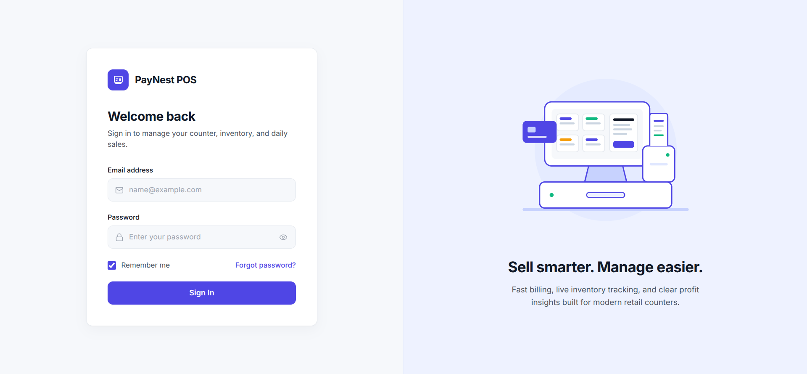
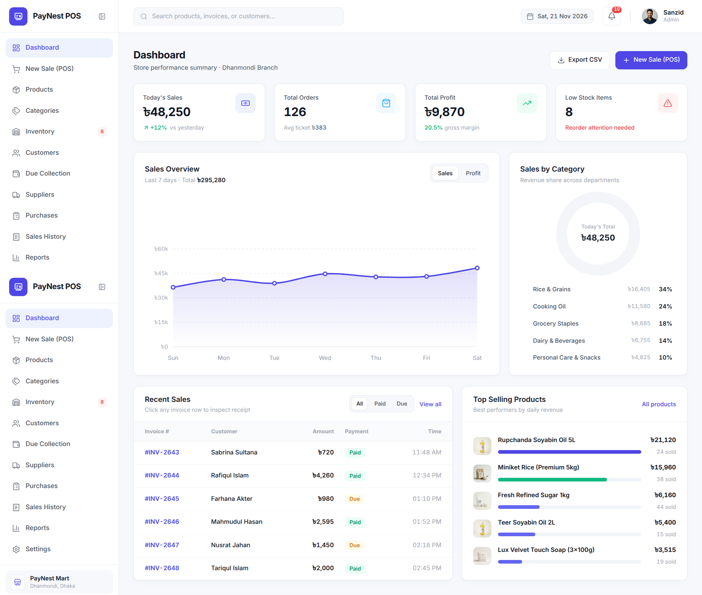
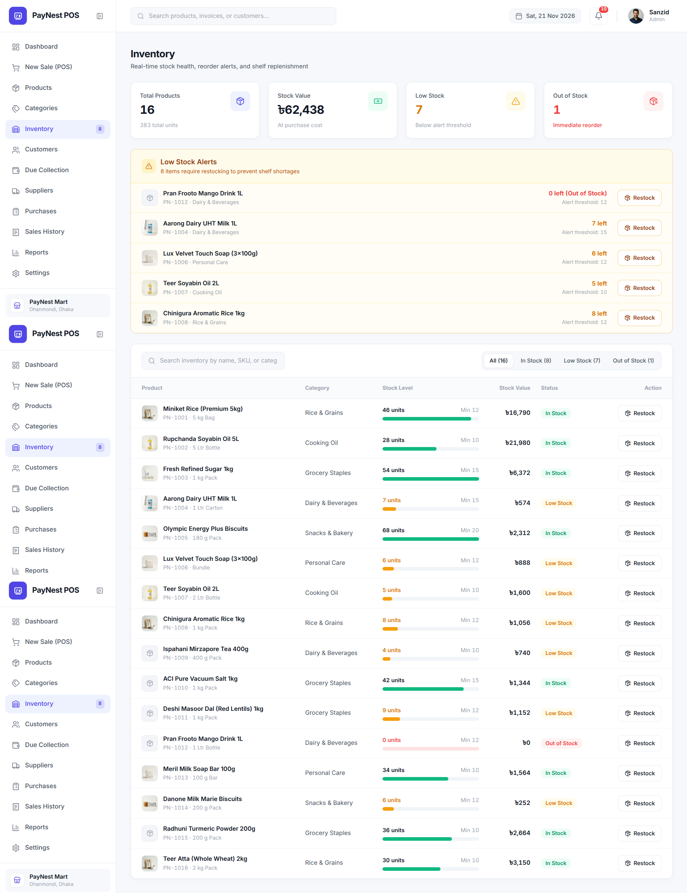
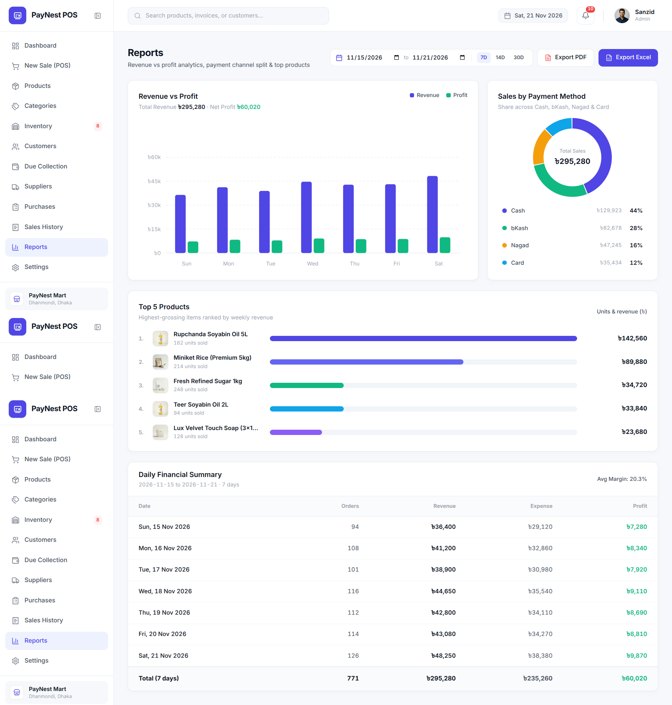

# PayNest Restaurant

PayNest Restaurant is a table-service management system for restaurants, cafés and food courts. It covers floor and table status, QR menu ordering, waiter order entry, a kitchen display, billing, ingredient stock, reports and staff roles. The React frontend talks to one Express API backed by SQLite; the guest QR page is a separate render tree with no staff session.

**Live demo:** [DEMO_URL] — replace this placeholder before publishing.

## Demo accounts

Demo rows are created only when `SEED_DEMO_DATA=true` and the `users` table is empty. Emails and passwords come from environment variables; a missing password generates a random value that is logged once at startup and stored only as a bcrypt hash.

| Role | Email | Password |
|---|---|---|
| Admin | `admin@example.com` | `[DEMO_PASSWORD]` |
| Manager | `manager@example.com` | `[DEMO_PASSWORD]` |
| Waiter | `waiter@example.com` | `[DEMO_PASSWORD]` |
| Kitchen | `kitchen@example.com` | `[DEMO_PASSWORD]` |
| Cashier | `cashier@example.com` | `[DEMO_PASSWORD]` |

Use your own `.env` values for a local demo; see [HowToSetup.md](./HowToSetup.md#demo-users).

## Features

- **Tables and QR codes** — floor tabs, status cards, table transfer, and signed, rotatable table QR codes printed from the staff **Table QR** screen.
- **Guest menu and ordering** — `/m/:token` lets guests browse available categories and variants, build a cart, place an order and poll its status without signing in. Server-owned prices are recomputed on every order.
- **Waiter orders** — category browsing, variants, item notes, a running order, send-to-kitchen, and confirmation of guest orders waiting in `pending_confirmation`.
- **Kitchen display** — New, Preparing and Ready columns, elapsed timers, large status actions, polling and an optional chime that is off by default.
- **Billing** — server-computed subtotals, VAT, service charge, discounts (cashier-capped), equal/item splits, cash/bKash/Nagad/Card payment recording, dues and print styles. No payment gateway is integrated.
- **Menu management** — categories, items, variants, prices, availability, prep stations and a picker for local `/images/...` assets.
- **Ingredient inventory** — ingredients, per-item recipes, stock ledger, manual adjustments, low-stock alerts and automatic deduction when an item is served.
- **Reports and administration** — runtime 7/14/30-day presets, daily sales, top items, table turnover, admin-only users and settings, and an auto-confirm switch for guest orders.
- **Installable web app** — local manifest and icons, a production-only service worker, an **Install app** action where the browser supports it, and an offline page that says live orders need a connection.

All money is stored as INTEGER minor units (paisa) — `55000` means `550.00` — and all totals are calculated by [server/billing.ts](./server/billing.ts). Clients only display values returned by the API, formatting every amount through `formatMoney()` in [src/utils/money.ts](./src/utils/money.ts). Ingredient stock, recipe quantities and stock movements stay decimal numbers in the API, rounded to at most three decimals by [server/stock.ts](./server/stock.ts).

## Screenshots

Image files are intentionally not committed. Add these exact PNG files to [docs/screenshots/](./docs/screenshots/); the links below will then render in GitHub.

| Screen | Image |
|---|---|
| Login |  |
| Dashboard |  |
| Tables |  |
| Waiter order |  |
| Kitchen |  |
| QR menu |  |
| Billing |  |
| Inventory |  |
| Reports |  |

## Tech stack

- **Frontend:** React 19, TypeScript 7, Vite 8, Tailwind CSS 4, Lucide icons and `qrcode.react` for local QR rendering.
- **Backend:** Express 4, `better-sqlite3`, bcrypt, `jsonwebtoken`, Helmet, CORS, cookie-parser, `express-rate-limit`, Zod and dotenv. esbuild bundles the server for production.
- **Tests:** Vitest, Testing Library, jsdom and Supertest.
- **Runtime:** Node `>=20.19.0`, npm `>=10`; `.nvmrc` pins `20.19.0`.

## Roles and permissions

Navigation is filtered for convenience only. Every privileged route is checked on the server from [server/permissions.ts](./server/permissions.ts) using `requirePermission` and `requireRole`.

| Role | Backend permissions | Home screen | Main areas |
|---|---|---|---|
| Admin | Full permissions, including users, settings and audit | Dashboard | Every screen |
| Manager | Tables, menu, orders, kitchen, bills, inventory, reports; no user or settings writes | Dashboard | Management, reporting and floor operations |
| Waiter | Menu/table/order/bill reads; order create, edit, transfer and serve; bill request | Tables | Tables and waiter order entry |
| Kitchen | Menu and inventory reads, availability, recipe reads, kitchen tickets and transitions | Kitchen display | Kitchen display and stock |
| Cashier | Table/order/bill reads; discounts, splits, payments and invoices | Billing | Table lookup and billing |

Managers cannot create admins because all user routes require the `admin` role. Users cannot change their own role or deactivate themselves, and the last active admin cannot be removed.

## Database summary

SQLite is opened by [server/db.ts](./server/db.ts). [docs/schema.sql](./docs/schema.sql) is applied on first start; WAL mode is enabled when the data directory is writable. `DB_PATH` controls the file location and resolves from the project root (or `PAYNEST_ROOT`).

| Area | Tables | Purpose |
|---|---|---|
| Access | `users` | Login identity, five-value role enum, active flag and bcrypt hash |
| Configuration | `settings` | Restaurant name, contact details, VAT %, service charge %, currency, receipt setup and guest-order auto-confirm |
| Dining room | `floors`, `tables` | Floor ordering, table number per floor, QR secret version and derived status |
| Menu | `menu_categories`, `menu_items`, `item_variants` | Categories, prices, local images, availability, prep station and variants |
| Inventory | `ingredients`, `recipe_items`, `stock_movements` | Stock thresholds, per-item recipes and the stock ledger |
| Orders | `orders`, `order_items` | Atomic order/bill numbers, server-owned totals and price snapshots |
| Payments | `payments`, `bill_splits` | Recorded method/amount and server-computed split plans |
| Kitchen | `order_item_events` | Per-item status history used for timers and audit |
| Tables | `table_transfers` | Server-owned transfer history |
| Reporting | `daily_sales` | Daily sales snapshots |
| Internals | `schema_version`, `number_sequences` | Idempotent migrations and atomic numbering |

Foreign keys are enabled on every connection. Order and bill numbers are allocated in `IMMEDIATE` transactions with `UNIQUE` constraints and retry, so gaps are possible but duplicates are not. See [docs/schema.sql](./docs/schema.sql) for keys, checks and indexes.

## QR ordering flow

1. An admin or manager opens **Table QR**, selects a table and prints its code. The code contains an HMAC-SHA256-signed payload `{ t: tableId, v: qrSecretVersion, exp: unixSeconds }`.
2. A guest scans the code and opens `/m/:token`. The public API validates the signature, version and expiry, then returns only available categories, items and variants. No staff, cost, stock or other-table data is exposed.
3. The guest submits a cart. The server strips client totals, resolves every unit price from the database and creates an order in `pending_confirmation`.
4. The guest page polls `/api/public/orders/:id` for status. Pending orders are excluded from kitchen tickets, billing and reports.
5. A waiter confirms the order from **Waiter order**, moving it to `new`; an admin can enable `autoConfirmPublicOrders` in **Settings** to skip this step.
6. Kitchen staff move items `new → preparing → ready` from the display. The `ready → served` transition is available through `/api/orders/:id/items/:itemId/serve` and deducts recipe stock in the same transaction.
7. Billing reads server totals, records payments and frees the table when the bill is paid.

Public routes are rate limited and require `Content-Type: application/json` for mutations. Rotating a table's QR version invalidates every previously printed code. See [docs/api.md](./docs/api.md#public-qr-ordering--apipublic).

## Progressive web app

`npm run build` copies the manifest, offline page, worker, routing script and generated icons from [public/](./public/) into `dist/`. The worker is registered only in production builds. It caches the static shell, `/assets/*`, `/images/*`, `/icons/*`, the manifest and the offline page in a versioned cache, and deletes older caches when a new version activates. **Nothing under `/api`, including `/api/public`, is cached or replayed**: those requests bypass the worker and always hit the server. Failed navigations show [public/offline.html](./public/offline.html), which states that live orders need a connection rather than implying the app works offline.

The **Install app** action appears in the profile menu only when the browser fires `beforeinstallprompt`; on iOS the menu shows **Share > Add to Home Screen** instead. Installability requires HTTPS in production (localhost is treated as secure) and a production build; `npm run dev` never registers the worker. Icons are generated from local drawing code with `npm run icons:generate` — no image dependency or remote asset is used. See [HowToSetup.md](./HowToSetup.md#installable-pwa-https) for deployment notes.

## Environment variables

Only backend and build-time variables are used; no secret is read through `VITE_*`. See [.env.example](./.env.example) and [server/config.ts](./server/config.ts).

| Variable | Used for | Default / behaviour |
|---|---|---|
| `JWT_SECRET` | Signing JWTs | Production requires 32+ characters; outside production an unset value generates a random per-process secret |
| `JWT_EXPIRES_IN` | JWT lifetime | `8h` |
| `DB_PATH` | SQLite file path | `./data/restaurant.db`, resolved from the project root |
| `PORT` | HTTP port | `3000` in production; dev API uses `3001` |
| `CORS_ORIGIN` | Comma-separated allowed cross-origin clients | `http://localhost:3000,http://127.0.0.1:3000`; `CORS_ORIGINS` is a fallback. Same-origin always works |
| `NODE_ENV` | Production cookies, JWT validation and login limit | Production-first; set by the compiled server when absent |
| `PAYNEST_ROOT` | Project-root override | Unset; not in `.env.example` |
| `API_TARGET` | Vite dev proxy target for `/api` | `http://127.0.0.1:3001`; not in `.env.example` |
| `DISABLE_HMR` | Disable Vite HMR and file watching | Unset; not in `.env.example` |
| `SEED_DEMO_DATA` | Create demo users, floors, tables, menu and sample orders | `false` |
| `ADMIN_EMAIL` … `CASHIER_EMAIL` | Demo emails for all five roles | Placeholders in `.env.example` |
| `ADMIN_PASSWORD` … `CASHIER_PASSWORD` | Demo passwords for all five roles | Placeholders; missing values are generated and logged once |
| `QR_TOKEN_SECRET` | Backend-only HMAC secret for table QR tokens | Production requires 32+ characters |
| `QR_TOKEN_TTL_SECONDS` | Printed-code lifetime | `31536000` (one year) |
| `MAX_CASHIER_DISCOUNT_PERCENT` | Cashier discount cap | `10` |

## Quick start

```bash
npm ci
cp .env.example .env
npm run dev
```

Open `http://localhost:3000` for the staff app. The API listens on `http://localhost:3001` in development and Vite proxies `/api` to it. Development uses `cross-env` for inline environment variables and `npm run clean` uses a Node-based cleanup script, so both work on Windows, macOS and Linux. For production, check [HowToSetup.md](./HowToSetup.md).

## Documentation

- [HowToSetup.md](./HowToSetup.md) — Node and Docker installs, branding, seed data, QR printing and deployment.
- [docs/api.md](./docs/api.md) — every endpoint, permission, request body and response.
- [docs/security-audit.md](./docs/security-audit.md) — dependency audit date and result.
- [LICENSE-NOTE.md](./LICENSE-NOTE.md) — template terms and dependency notices.
- [CHANGELOG.md](./CHANGELOG.md) — release notes.
